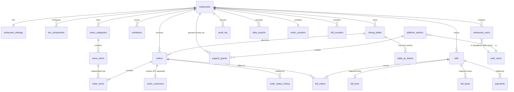

# DineFlow — Technical Design, Part 1: Database

| | |
|---|---|
| **Version** | 0.1 (Stage 2 draft for approval) |
| **Engine** | PostgreSQL (Supabase managed) |
| **Status** | Design only. SQL migrations are written **after** you approve this schema (PRD §7). The DDL below is design-grade, not final migration code. |

---

## 1. Conventions

| Topic | Convention |
|---|---|
| Primary keys | `uuid` (`gen_random_uuid()`), except counters and the audit log (`bigint identity`). Public identifiers exposed to customers are separate random tokens, never row IDs. |
| Tenant column | Every restaurant-owned table has `restaurant_id uuid NOT NULL REFERENCES restaurants(id)`. |
| **Tenant-matching foreign keys** | Parents that other tenant tables reference get `UNIQUE (id, restaurant_id)`. Children reference `(parent_id, restaurant_id)`. This makes it **impossible at the database level** to link an order item to another restaurant's menu item, whatever the application does. |
| Money | `bigint` **minor units** (paise/cents), `CHECK (>= 0)` and a sane upper bound (`<= 1_000_000_000_00`). Currency is a per-restaurant `char(3)`; v1 supports two-decimal currencies only. **No floating point, no `numeric` arithmetic in app code.** |
| Rates | Basis points (`integer`, 500 = 5.00 %), `CHECK (0..10000)`. |
| Rounding | Half-up on minor units, implemented once in the shared TypeScript `money` module and re-verified in database constraints on finalization. |
| Timestamps | `timestamptz`, stored UTC, `created_at`/`updated_at` on all mutable tables (trigger-maintained). Restaurant timezone is used **only** for display and for "today" boundaries. |
| Text | Names/descriptions length-limited by `CHECK`. All user text is treated as plain text everywhere. |
| Enums | Native Postgres enums for closed sets that rarely change; lookup tables for anything restaurant-configurable. |
| Soft delete | `archived_at timestamptz` for catalogue rows; `status` for users/restaurants. Financial and audit rows are never deleted by the application. |
| Optimistic concurrency | `version integer NOT NULL DEFAULT 1` on orders and bills; updates use `WHERE id = $1 AND version = $2`. |
| Naming | `snake_case`, plural tables (`dining_tables` rather than the reserved-ish `tables`). |
| Case-insensitive uniqueness | `UNIQUE INDEX … (restaurant_id, lower(label))`. |
| Extensions | `pgcrypto` (random tokens), `citext` (emails), `pg_cron` (retention jobs), `pgtap` (tests, dev/staging only). |

## 2. Entity-relationship diagram



Every entity below `restaurants` also carries `restaurant_id` (omitted from arrows for readability). `platform_admins` is the only table that is not tenant-scoped besides `restaurants` itself.

## 3. Table catalogue

### 3.1 Platform and tenant core

**`restaurants`** — one row per tenant.
```sql
id uuid PK, slug text UNIQUE (url-safe, immutable after first use),
name text, status restaurant_status NOT NULL DEFAULT 'provisioning',   -- provisioning|active|suspended|closed
accepting_orders boolean NOT NULL DEFAULT false,
currency char(3) NOT NULL DEFAULT 'INR', timezone text NOT NULL DEFAULT 'Asia/Kolkata',
logo_path text, brand_color char(7) CHECK (brand_color ~ '^#[0-9a-fA-F]{6}$'),
address_line1..., city, region, postal_code, country, phone, email,
opening_hours_text text, created_at, updated_at, version int,
```
`status` changes only via platform-admin functions (trigger-enforced). Suspended/closed restaurants fail every staff RLS check and public token resolution.

**`restaurant_settings`** (1:1) — billing/ordering configuration owned by the Owner.
```sql
restaurant_id uuid PK FK, contact_policy contact_policy NOT NULL DEFAULT 'optional', -- off|optional|require_mobile|require_email|require_both
order_prefix text DEFAULT '' CHECK (length <= 6),
prices_include_tax boolean NOT NULL DEFAULT true,       -- inclusive vs exclusive pricing
service_charge_bps int NOT NULL DEFAULT 0,
tax_registration_no text NULL, bill_footer text NULL,
rounding_mode rounding_mode NOT NULL DEFAULT 'none',    -- none|nearest_50|nearest_1  (in minor units: 50 = 0.50)
max_qty_per_line int NOT NULL DEFAULT 20, max_items_per_order int NOT NULL DEFAULT 60,
manager_discount_cap_bps int NOT NULL DEFAULT 2000,
allow_customer_cancel boolean NOT NULL DEFAULT false,
customer_data_retention_days int NULL,                  -- NULL = keep until Owner deletes
require_table_code boolean NOT NULL DEFAULT false,      -- reserved hook, unused in v1 (D-16)
updated_at, updated_by
```

**`tax_components`** — named tax lines per restaurant.
```sql
id, restaurant_id, name text, rate_bps int, sort_order int, active boolean, UNIQUE (restaurant_id, lower(name))
```

**`platform_admins`** — `user_id uuid PK → auth.users`, `created_at`. Not tenant-scoped; MFA (aal2) mandatory.

**`restaurant_users`** — staff membership (and the only source of a user's role).
```sql
id, restaurant_id, user_id uuid UNIQUE → auth.users   -- one restaurant per user in v1 (FR-107)
role staff_role NOT NULL,                             -- owner|manager|kitchen|billing
status staff_status NOT NULL,                         -- active|deactivated   (invited users exist only in `invitations` until accepted)
email citext NOT NULL, display_name text,
created_at, created_by, deactivated_at, deactivated_by,
UNIQUE (restaurant_id, user_id)
```
Partial unique/guard trigger: at least one `active owner` must remain per restaurant (BR-USR-01).

**`invitations`** — `id, restaurant_id, email, role, token_hash (SHA-256 of a 256-bit token), expires_at (72 h), accepted_at, revoked_at, invited_by`. Token appears only in the email link; single use.

**`support_grants`** — `id, restaurant_id, admin_user_id, reason text NOT NULL, created_at, expires_at (≤ 4 h), revoked_at`. Read by the Owner (transparency, FR-123).

### 3.2 Tables and QR

**`dining_tables`** — as built in migration 006. It follows the Module 3 product decisions rather than the earlier sketch: a `table_number` plus an optional `name` replace `label`/`notes`, a `capacity` is added, and a `status` enum replaces `active` + `archived_at`.
```sql
id, restaurant_id,
table_number text CHECK (trimmed, length 1..20),   -- unique per restaurant, case-insensitive
name text NULL CHECK (trimmed, length 1..60),
capacity integer CHECK (1..100),
status table_status NOT NULL DEFAULT 'active',     -- active | inactive
created_at, updated_at, version,
UNIQUE (id, restaurant_id),
UNIQUE INDEX (restaurant_id, lower(table_number))
```
No role holds DELETE. Hard deletion of a table with no order history (FR-012) waits for the orders module; until then tables are deactivated.

**`table_qr_tokens`** — see Part 7 §5 for the token format (the row holds **no usable token**).
```sql
id, restaurant_id, table_id,
qr_id uuid NOT NULL UNIQUE,        -- random; the printable token is HMAC(qr_id) computed by the API, never stored
key_id smallint NOT NULL,          -- which signing key produced tokens for this qr_id
created_at, created_by, revoked_at NULL,
FK (table_id, restaurant_id) → dining_tables(id, restaurant_id),
UNIQUE INDEX (table_id) WHERE revoked_at IS NULL                  -- exactly one live token per table
```
Public roles have **no** table privileges here; they use the `SECURITY DEFINER` function `app.resolve_table_qr(qr_id)`, called only after the API has verified the token's MAC in memory. It returns `(restaurant_id, table_id)` only if the token is live, the table is active and the restaurant is `active`.

### 3.3 Menu

**`menu_categories`** — `id, restaurant_id, name, sort_order, visible boolean, archived_at, created_at, updated_at, UNIQUE (id, restaurant_id), UNIQUE INDEX (restaurant_id, lower(name)) WHERE archived_at IS NULL`.

**`menu_items`**
```sql
id, restaurant_id, category_id, name text (1..120), description text (<=1000),
price_minor bigint CHECK (price_minor BETWEEN 0 AND 100000000000),
image_path text NULL, diet diet_type NOT NULL DEFAULT 'none',       -- veg|non_veg|egg|none
available boolean NOT NULL DEFAULT true, visible boolean NOT NULL DEFAULT true,
sort_order int, archived_at, created_at, updated_at,
UNIQUE (id, restaurant_id),
FK (category_id, restaurant_id) → menu_categories(id, restaurant_id)
```
A trigger limits what the Kitchen role may change to `available` (+`updated_at`) only.

### 3.4 Orders

**`orders`**
```sql
id, restaurant_id, table_id, order_no int NOT NULL, order_ref text NOT NULL,      -- e.g. 'A-1042'
status order_status NOT NULL DEFAULT 'pending',       -- pending|accepted|preparing|ready|served|cancelled
subtotal_minor bigint NOT NULL,                       -- sum of line totals, pre-tax
special_instructions text NULL CHECK (length <= 500),
public_token_hash bytea NOT NULL UNIQUE,              -- SHA-256 of the customer's status-page token; the token itself is never stored (Part 7 §5)
idempotency_key text NOT NULL, request_hash bytea NOT NULL,
cancel_reason text NULL, cancelled_by uuid NULL,
placed_at timestamptz NOT NULL DEFAULT now(), status_updated_at timestamptz NOT NULL DEFAULT now(),
version int NOT NULL DEFAULT 1,
UNIQUE (id, restaurant_id),
UNIQUE (restaurant_id, order_no),
UNIQUE (restaurant_id, idempotency_key),
FK (table_id, restaurant_id) → dining_tables(id, restaurant_id)
```
`subtotal_minor` contains **no personal data**, so it (and the whole `orders` table) is safe to expose to the Kitchen role.

**`order_items`** — immutable line snapshots.
```sql
id, restaurant_id, order_id, menu_item_id, name_snapshot text, unit_price_minor bigint,
quantity int CHECK (quantity BETWEEN 1 AND 99), line_total_minor bigint GENERATED ALWAYS AS (unit_price_minor * quantity) STORED,
item_note text NULL CHECK (length <= 200),
FK (order_id, restaurant_id) → orders(id, restaurant_id),
FK (menu_item_id, restaurant_id) → menu_items(id, restaurant_id)     -- cross-tenant reference impossible
```
`UNIQUE (id, restaurant_id)` for `bill_lines` to reference.

**`order_customers`** — personal data isolated from operational data.
```sql
order_id PK, restaurant_id, mobile text NULL, email citext NULL, consent_at timestamptz NOT NULL, anonymized_at NULL,
FK (order_id, restaurant_id) → orders(id, restaurant_id)
```
Kitchen role has **no** privilege on this table. Retention job nulls `mobile`/`email` and stamps `anonymized_at`.

**`order_status_history`** — append-only. `id bigint identity, restaurant_id, order_id, from_status NULL, to_status, changed_by uuid NULL (NULL = customer/system), reason text NULL, created_at`. Rows are written by an `AFTER INSERT OR UPDATE OF status` trigger on `orders`, so no code path can change a status without leaving a history row.

**`order_counters`** — `restaurant_id PK, next_no int NOT NULL DEFAULT 1`. Allocated by `app.next_order_no(restaurant_id)` (one `UPDATE … RETURNING` inside the order transaction; row lock serialises concurrent orders; rollback returns the number, so no gaps).

### 3.5 Billing

**`bills`**
```sql
id, restaurant_id, table_id, status bill_status NOT NULL DEFAULT 'draft',    -- draft|finalized|void
bill_series text NOT NULL DEFAULT 'main', bill_no int NULL, bill_ref text NULL,  -- assigned at finalization only
currency char(3), prices_include_tax boolean,                     -- snapshot
subtotal_minor bigint, discount_type discount_type NULL, discount_value bigint NULL,   -- 'percent' (bps) | 'fixed' (minor)
discount_minor bigint NOT NULL DEFAULT 0, discount_reason text NULL,
service_charge_bps int, service_charge_minor bigint NOT NULL DEFAULT 0,
tax_total_minor bigint NOT NULL DEFAULT 0, rounding_minor bigint NOT NULL DEFAULT 0,   -- may be negative
total_minor bigint NOT NULL,
issuer_snapshot jsonb NOT NULL,                                   -- restaurant name, address, contact, tax reg no, footer, logo path as at finalization
created_by, created_at, finalized_by, finalized_at, voided_by, voided_at, void_reason,
version int NOT NULL DEFAULT 1,
UNIQUE (id, restaurant_id),
UNIQUE (restaurant_id, bill_series, bill_no) WHERE bill_no IS NOT NULL
```
Payment status is **derived** (a bill is paid iff it has a non-reversed payment); it is deliberately not stored, so finalized bill rows have exactly one mutation left (voiding).

**`bill_orders`** — `bill_id, order_id, restaurant_id, voided boolean NOT NULL DEFAULT false`, PK `(bill_id, order_id)`, composite FKs, **`UNIQUE INDEX (order_id) WHERE voided = false`** so an order belongs to at most one live (draft/finalized) bill (BR-BILL-01). A trigger sets `voided = true` when its bill is voided.

**`bill_lines`** — snapshot: `id, restaurant_id, bill_id, order_item_id, name, quantity, unit_price_minor, line_total_minor`.
**`bill_taxes`** — snapshot: `id, restaurant_id, bill_id, name, rate_bps, taxable_minor, amount_minor`.

**`bill_counters`** — `restaurant_id, series, next_no, PK (restaurant_id, series)`; `app.next_bill_no()` allocates at finalization inside the same transaction → **gap-free** (BR-BILL-03).

**`payments`**
```sql
id, restaurant_id, bill_id, method payment_method NOT NULL,       -- cash|card|upi|other
amount_minor bigint CHECK (amount_minor > 0), reference text NULL CHECK (length <= 80),
recorded_by uuid NOT NULL, recorded_at timestamptz NOT NULL DEFAULT now(),
reversed_at NULL, reversed_by NULL, reversal_reason NULL,
FK (bill_id, restaurant_id) → bills(id, restaurant_id),
UNIQUE INDEX (bill_id) WHERE reversed_at IS NULL                 -- at most one live payment (v1: no partial payments)
```
A constraint trigger requires the bill to be `finalized` and `amount_minor = bills.total_minor`.

### 3.6 Audit, exports

**`audit_log`** — `id bigint identity, restaurant_id NULL (NULL for platform-level events), actor_user_id NULL, actor_role text, action text, entity_type text, entity_id text, summary jsonb (no secrets, no full PII), ip inet NULL, user_agent text NULL, request_id text, created_at`. Append-only.

**`data_exports`** — `id, restaurant_id, requested_by, status (queued|running|ready|failed|expired), file_path, created_at, expires_at (7 days)`; files live in a **private** bucket and are served through short-lived signed URLs.

## 4. Lifecycles and rules enforced in the database

### 4.1 Order status (FR-053)

```
pending ──► accepted ──► preparing ──► ready ──► served
   │            │            │
   └────────────┴────────────┴──► cancelled        (served and cancelled are terminal)
Owner/Manager only: "revert one step" (accepted→pending, preparing→accepted, ready→preparing); served→ready only if the order is on no live bill.
```
Role permissions per transition (mirrors PRD §8): Kitchen: `pending→accepted`, `accepted→preparing`, `preparing→ready`, and cancel from `pending/accepted` with a reason; Billing: `ready→served`; Owner/Manager: all. Enforced by a `BEFORE UPDATE` trigger using a transition table function, **and** in the API using the shared TypeScript state machine. A contract test asserts both agree for every (role, from, to) triple.

### 4.2 Bill lifecycle (FR-076/077)

| From → To | Who | Conditions |
|---|---|---|
| (new) → `draft` | Owner, Manager, Billing | Orders belong to the restaurant and the same table, none cancelled, none already on a live bill. Lines/taxes snapshotted from `order_items` and current tax config. |
| `draft` edit | Owner, Manager (discount) | Only discount fields; cap enforced; reason mandatory. |
| `draft` → `finalized` | Owner, Manager, Billing | Recompute and verify totals; allocate `bill_no`; freeze issuer snapshot. |
| `finalized` → `void` | Owner, Manager | Reason mandatory; **no live payment** (reverse it first). |
| `draft` → deleted | Owner, Manager, Billing | A never-finalized draft may be discarded (it consumed no bill number); the discard is audited. |

After `finalized`, a trigger rejects any `UPDATE` to `bills` except the `finalized → void` transition (and its void columns), any change to `bill_lines`, `bill_taxes`, `bill_orders` (except `voided` flag via the void trigger), and every `DELETE`. Application roles additionally lack `DELETE`/most `UPDATE` privileges on these tables.

**Arithmetic (all minor units, half-up rounding):**
```
subtotal      = Σ line_total
discount      = percent ? round(subtotal × bps / 10000) : fixed          (≤ subtotal)
base          = subtotal − discount
service       = round(base × service_bps / 10000)
exclusive:    tax_i = round(base × rate_i / 10000)                        (service charge is not taxed by default; see note)
inclusive:    tax_i = round(gross_i × rate_i / (10000 + rate_i))           (extracted from price; total unchanged by tax)
pre_round     = exclusive ? base + service + Σtax : base + service
total         = pre_round + rounding_adjustment (per rounding_mode)
```
Note: whether a service charge is itself taxable differs by jurisdiction; v1 treats the service charge as **not** taxable unless the restaurant configures otherwise — flagged for accountant review (BR-BILL-08). A constraint trigger on finalization recomputes the identity `total = subtotal − discount + service + Σtax(if exclusive) + rounding` from the stored components and fails the transaction on mismatch.

### 4.3 Restaurant and user lifecycle

- `provisioning → active` when the Owner finishes onboarding; `active ↔ suspended`; `→ closed`. Only platform-admin functions may change `status`.
- Staff are never deleted; `deactivated` users fail RLS immediately (membership lookup is part of every request). The last active Owner cannot be deactivated or demoted (trigger).

## 5. Integrity mechanisms (summary)

| Guarantee | Mechanism |
|---|---|
| No cross-tenant references | Composite `(id, restaurant_id)` foreign keys everywhere. |
| No duplicate orders | `UNIQUE (restaurant_id, idempotency_key)`; same key with a different request hash → 409, not a second order. |
| Order numbers unique, gap-free | Counter row + `UNIQUE (restaurant_id, order_no)`, allocated in the same transaction. |
| Bill numbers unique, gap-free | Counter row + partial unique index; allocated at finalization only. |
| Order total correct | Deferred constraint trigger: `orders.subtotal_minor = Σ order_items.line_total_minor`. |
| Bill total correct | Finalization trigger recomputes from components (§4.2). |
| Finalized bills immutable | Triggers + privilege revocation (§4.2). |
| Payments append-only | Only reversal columns may be set once; no deletes. |
| Audit and history append-only | `REVOKE UPDATE, DELETE` + trigger raising an exception. |
| Valid status transitions | `BEFORE UPDATE` trigger + role-aware transition function. |
| One live QR per table | Partial unique index. |
| Last owner protected | Constraint trigger on `restaurant_users`. |
| Concurrent edits safe | `version` column + conditional `UPDATE`; row locks (`SELECT … FOR UPDATE`) on counters, bills at finalize. |

## 6. Row-Level Security design

### 6.1 Database roles

| Role | Purpose | Capabilities |
|---|---|---|
| `postgres` / migration owner | Owns objects; used **only by CI migrations** | Full. Never used by the running API. |
| `dineflow_api` | The API's `LOGIN` role (via the Supabase pooler) | `NOSUPERUSER NOBYPASSRLS`, owns nothing, **no table privileges**; may `SET ROLE` to the two roles below and `EXECUTE` the membership lookup. |
| `dineflow_staff` (`NOLOGIN`) | Staff and platform-admin requests, after `SET LOCAL ROLE` | Table privileges as per the matrix below, filtered by RLS. **Not** Supabase's `authenticated` role (Part 7 §3, F-1): `anon`, `authenticated` and `service_role` receive no privileges on any DineFlow table, and the Data API is disabled. |
| `dineflow_public` (`NOLOGIN`) | Unauthenticated customer requests | `SELECT` on **specific columns** of public-safe tables; `INSERT` on order tables; `EXECUTE` on resolver functions; filtered by RLS to the single resolved restaurant. |
| `dineflow_ops` | Purge/retention `SECURITY DEFINER` functions and backups | Narrow; not reachable from the API. |

Per request the API does, inside one transaction (values bound as parameters):
```sql
SET LOCAL ROLE dineflow_staff;                                  -- or dineflow_public
SELECT set_config('request.jwt.claims', $claims_json, true);    -- {"sub": "<verified user id>", "role":"dineflow_staff", "aal":"aal1|aal2"}
-- public requests instead:  SELECT set_config('app.public_restaurant_id', $rid, true);
```
The claims are populated **only after** the API has verified the session token's signature and the membership lookup succeeded.

### 6.2 Helper functions (`app` schema, `SECURITY DEFINER`, `STABLE`, fixed `search_path`)

`app.uid()`, `app.restaurant_id()` (active membership of an **active** restaurant, else NULL), `app.role()`, `app.is_platform_admin()` (requires `aal2`), `app.has_support_grant(rid)`, `app.public_restaurant_id()`. Policies call them as `(SELECT app.restaurant_id())` so the planner evaluates them once per statement.

### 6.3 Policy matrix

R = SELECT · W = INSERT/UPDATE (DELETE only where noted). "own" = `restaurant_id = (SELECT app.restaurant_id())`.

| Table | Owner | Manager | Kitchen | Billing | Public (QR token) | Platform admin |
|---|---|---|---|---|---|---|
| `restaurants` | R, W (profile) | R, W (profile, `accepting_orders`) | R | R | R (public columns) | R, W all incl. `status` |
| `restaurant_settings` | R, W | R | — | R | R (limits/contact policy) | — |
| `tax_components` | R, W | R | — | R | R (for estimate) | — |
| `restaurant_users`, `invitations` | R, W all roles | R; W kitchen/billing only | — | — | — | — |
| `dining_tables` | R, W | R, W | R | R | via resolver only | — |
| `table_qr_tokens` | R, W | R, W | — | — | resolver only | — |
| `menu_categories` | R, W | R, W | R | R | R (visible, not archived) | — |
| `menu_items` | R, W | R, W | R, W(`available` only) | R | R (visible, not archived) | — |
| `orders` | R, W (status) | R, W (status) | R, W (allowed transitions) | R, W (`ready→served`) | INSERT own restaurant; no SELECT | — |
| `order_items` | R | R | R | R | INSERT with the order | — |
| `order_customers` | R | R | **—** | R | INSERT with the order | — |
| `order_status_history` | R | R | R | R | — (written by trigger) | — |
| `bills`, `bill_lines`, `bill_taxes`, `bill_orders` | R, W | R, W | — | R, W (no discount) | — | — |
| `payments` | R, W (incl. reverse) | R, W (incl. reverse) | — | R, W (record only) | — | — |
| `audit_log` | R all; INSERT | R limited action set; INSERT | INSERT | INSERT | — | R platform-level rows |
| `support_grants` | R own | — | — | — | — | R, W |
| `data_exports` | R, W | — | — | — | — | R, W |
| `platform_admins` | — | — | — | — | — | R self |

**Support grants:** with a live grant, `SELECT`-only policies on business tables also admit `app.is_platform_admin() AND app.has_support_grant(restaurant_id)`. No write policy ever admits a platform admin on tenant business tables.

### 6.4 Design cautions and limits

- Policies are `USING` **and** `WITH CHECK` so writes cannot move a row to another tenant.
- `FORCE ROW LEVEL SECURITY` on all tenant tables; `REVOKE ALL … FROM PUBLIC`, `anon`, `authenticated`, `service_role`; default privileges revoked so future tables are closed by default (Part 7 §3, F-7).
- **Honest limit:** this RLS design protects against missing filters, IDOR bugs and wrong-ID requests. It does **not** protect against an attacker who achieves arbitrary SQL execution (they could `SET ROLE` or `set_config`). That risk is addressed by parameterised-only queries (Kysely, no string-built SQL, lint rule), not by RLS. The same limit applies to Supabase's own JWT-claims model.
- Column-level restrictions that RLS cannot express (Kitchen may only toggle availability; Manager cannot change `status` or tax settings) are enforced by `BEFORE UPDATE` triggers reading `app.role()`.

## 7. Indexes (initial set; revisit with `pg_stat_statements` and load tests)

| Table | Index | Serves |
|---|---|---|
| `orders` | `(restaurant_id, status, placed_at DESC)` | Order dashboard, kitchen view |
| `orders` | `(restaurant_id, placed_at DESC)` | Order list, today's counts |
| `orders` | `(restaurant_id, table_id, status)` | Table status, billing lookup |
| `orders` | `(restaurant_id, status_updated_at)` | Polling cursor (`since`) |
| `order_items` | `(order_id)` | Order detail |
| `menu_items` | `(restaurant_id, category_id, sort_order) WHERE archived_at IS NULL` | Public menu |
| `bills` | `(restaurant_id, status, created_at DESC)`; `(restaurant_id, finalized_at)` | Billing list, sales reports |
| `payments` | `(restaurant_id, recorded_at)`; `(bill_id) WHERE reversed_at IS NULL` | Reports, paid check |
| `audit_log` | `(restaurant_id, created_at DESC)`; `(restaurant_id, entity_type, entity_id)` | Audit views |
| `restaurant_users` | `(user_id)` unique already; `(restaurant_id, role)` | Membership lookup on **every** request (must be sub-millisecond) |
| `table_qr_tokens` | unique `(token)` | Public resolution |
| `orders` | unique `(public_token_hash)` | Customer status page |
| FKs | Index on every foreign-key column not otherwise indexed | Joins, restrict checks |

## 8. Deletion, retention and data lifecycle

| Data | Behaviour |
|---|---|
| Menu categories/items, tables | Archived, never deleted if referenced. Unreferenced tables may be hard-deleted. |
| Orders, bills, payments, status history, audit log | Never deleted by application code. Retention period to be set contractually (BR-DATA-02, **lawyer/accountant to advise**). |
| Customer contact (`order_customers`) | Owner can delete/anonymise per order or in bulk; optional automatic anonymisation after N days (nightly `pg_cron` job; per-restaurant setting). |
| Staff | Deactivated, never deleted. |
| Offboarding | Suspend → export → retention period → `app.purge_restaurant(id)` (ops-only `SECURITY DEFINER` function that deletes in dependency order after triggers verify the caller is the ops role and the restaurant is `closed` beyond its retention date) → storage prefix purge. Foreign keys are `ON DELETE RESTRICT` everywhere; there is **no** `CASCADE` from `restaurants`. |
| Export | Streaming ZIP built from tenant-scoped queries (CSV/JSON + bill PDFs). |

## 9. Migration plan (written after approval)

- Tool: Supabase CLI, timestamped SQL files in `supabase/migrations/`, reviewed in PRs, applied by CI (staging automatically, production after approval).
- Expand/contract discipline: additive first; destructive changes only in a later release after the code no longer depends on them. Each migration notes its rollback approach.
- Proposed sequence:

| # | Migration | Contents |
|---|---|---|
| 001 | Foundations | Extensions, schemas (`app`), roles and grants, enums, `updated_at` trigger |
| 002 | Tenants and staff | `restaurants`, `restaurant_settings`, `tax_components`, `platform_admins`, `restaurant_users`, `invitations`, helper functions, RLS + tests |
| 003 | Tables and QR | `dining_tables`, `table_qr_tokens`, resolver function, RLS + tests |
| 004 | Menu | Categories, items, kitchen-column trigger, public column grants, RLS + tests |
| 005 | Orders | Orders, items, customers, history, counters, transition and totals triggers, RLS + tests |
| 006 | Billing | Bills, lines, taxes, bill_orders, counters, payments, immutability triggers, RLS + tests |
| 007 | Audit and support | `audit_log`, `support_grants`, `data_exports`, append-only guards |
| 008 | Retention and ops | `pg_cron` jobs, purge function |

Each migration ships with its pgTAP tests in the same PR (Part 4). The RLS test harness is built in migration 002, **before** any business table exists, so every later table inherits it (the sequencing change I recommended in the PRD).

## 10. Backup and restore (database view)

Detailed in Part 0 §6. Summary: Supabase daily backups + our encrypted 6-hourly dumps, restore drills before go-live and quarterly, per-tenant export for offboarding. The dump includes the `auth` schema (needed to restore logins) and is therefore encrypted before leaving the CI runner; the decryption key is held offline by you and one nominated backup holder.
